<p align="center">
  
</p>

<h3 align="center">I build tools for coding agents, and side quests for everything else.</h3>
<p align="center">MCP servers · skills · subagents · OpenTelemetry · a database · a metro scheduler · an RPG for real life</p>

<br>

#### Quest log

| rank | quest | what it is |
|:---:|---|---|
| **S** | **[Agentic Resource Registry](https://github.com/AgenticResourceRegistry/AgenticResourceRegistry)**<br><sub>formerly Observal · main quest</sub><br><a href="https://github.com/AgenticResourceRegistry/AgenticResourceRegistry"></a> | Share and discover coding agent resources across your team: MCP servers, skills, hooks, prompts and agents. Self-hosted, works with Claude Code, Kiro, Cursor, Codex and Pi. I work on telemetry (OTel export), A2A delegation and MCP sync. |
| **A** | **ARISE**<br><sub>side quest · Electron, React, SQLite</sub> | A Solo Leveling style life manager. Habits earn XP, stats rank up from E to S, goals become campaign maps you clear checkpoint by checkpoint. |
| **A** | **[nammaDB](https://github.com/Lokesh7025/nammaDB)**<br><sub>side quest · Go</sub> | A file-based relational database from scratch: B+Tree storage, MVCC concurrency and an interactive CLI. |
| **B** | **[KRONOS](https://github.com/Lokesh7025/KRONOS)**<br><sub>side quest · Python</sub> | Nightly fleet scheduling for Kochi Metro. A Random Forest predicts each train's risk, then OR-Tools CP-SAT plans the fleet around it. |

#### `→ tools/list`

```jsonc
// ← {"jsonrpc": "2.0", "id": 1, "result": { "tools": [...] }}
{
  "ship_registry":     "Agentic Resource Registry: MCPs, skills and agents for teams",
  "wire_otel_traces":  "Claude Code, Codex, Copilot, Goose sessions → OTel spans",
  "level_up_irl":      "ARISE: habits → XP, goals → campaign maps",
  "write_a_database":  "nammaDB: B+Tree, MVCC, no ORM was harmed",
  "schedule_trains":   "KRONOS: predict, then optimize, then catch the metro",
  "debug_wsl_at_3am":  "Undocumented. Side effects may include rebuilding $HOME"
}
```

#### `SKILL.md`

```yaml
---
name: lokesh
description: >
  Use when an agent needs a registry, a trace or a teammate, when a token
  count looks suspiciously high, or when a side project needs a B+Tree, a
  CP-SAT solver or an XP curve.
not-for: centering a div on the first try
---
```

#### Recent tool calls

<!-- tool-calls:start -->
```text
Nov 06  ● gh pr create "feat(usage-ping): add ide…"  AgenticResourceRegistry#2039
Nov 01  ● git push origin pr-assets-2013-review      AgenticResourceRegistry ×2
Nov 01  ● git switch -c pr-assets-2013-review        AgenticResourceRegistry
Nov 03  ● git push origin refactor/otel-package      AgenticResourceRegistry
Nov 03  ● gh pr review --comment                     AgenticResourceRegistry#1783 ×2
Nov 01  ● git switch -c feat/arr-default-branding    AgenticResourceRegistry
Nov 03  ● gh issue comment                           AgenticResourceRegistry#1784
```
<!-- tool-calls:end -->

<sub>Pulled from my public GitHub activity by a <a href=".github/workflows/tool-calls.yml">daily Action</a>. No agents were harmed.</sub>

#### `/context`

```text
Python      ██████████████░░░░░░  agents, MCP servers, KRONOS
TypeScript  █████████░░░░░░░░░░░  ARISE, dashboards, Remotion videos
Go          █████░░░░░░░░░░░░░░░  nammaDB
Java        ████░░░░░░░░░░░░░░░░  pipelines and services
Free space  ██░░░░░░░░░░░░░░░░░░  auto-compact imminent
```

<p align="center"><sub>Context left until auto-compact: 3%. Say hi before I forget everything.</sub></p>
